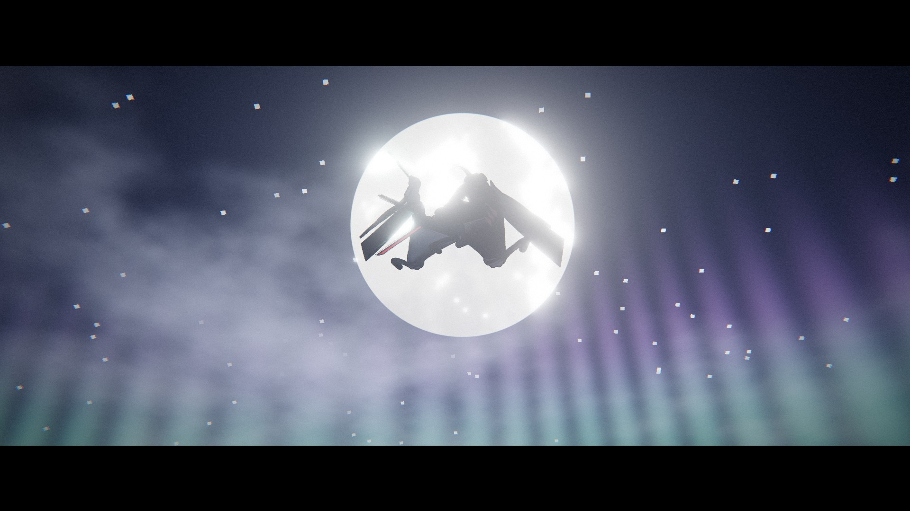
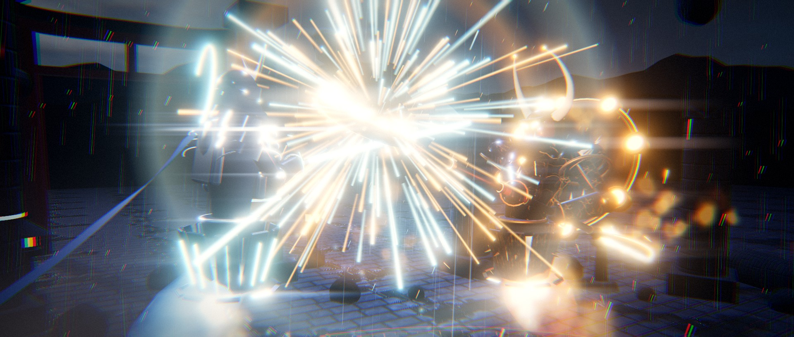

# 코드로 만든 대결 영상

외부 그림·소리 파일 없이, 그래픽과 사운드를 전부 코드로 생성한 영상입니다.

| | 영상 | 스타일 | 길이 | 결과물 |
|---|---|---|---|---|
| 1 | **SPIRIT CLASH — 혼의 격돌** | 3D (three.js / WebGL) | 15초 | [`output/spirit_clash.mp4`](output/spirit_clash.mp4) |
| 2 | **AURORA BLADE — 오로라의 검** | 2D 셀 애니메이션풍 (Canvas 2D) | **30초** | [`output/aurora_blade_30s.mp4`](output/aurora_blade_30s.mp4) |

모든 캐릭터는 이 프로젝트를 위해 새로 디자인한 오리지널 캐릭터입니다.
(`output/aurora_blade.mp4`는 이전 15초 버전으로, 커밋 `f0ab205`의 코드로 만들어졌습니다.)

---

# 2. AURORA BLADE — 오로라의 검 (2D, 30초)

**결과물:** [`output/aurora_blade_30s.mp4`](output/aurora_blade_30s.mp4) — 1920×1080, 24fps, 30초, 스테레오 사운드



## 등장 캐릭터 (오리지널)

| | 세라 (星羅) · 극광의 검사 | 흑야 (黑夜) · 먹의 귀검사 |
|---|---|---|
| 실루엣 | 무릎까지 오는 은발 포니테일(끝이 청록→보라로 물듦), 더듬이 머리, 바람에 펄럭이는 흰 하오리 | 거대한 진홍 갈기, 너덜너덜한 검은 하오리, 넓은 어깨 갑옷 |
| 얼굴 | 오드아이(오른쪽 보라·왼쪽 청록), 눈 밑 점, 초승달 귀걸이 | 이빨을 드러내고 웃는 흰 가면, 붉게 빛나는 외눈, 한쪽이 부러진 뿔 |
| 장식 | 초승달 머리장식과 흔들리는 별 장식, 오로라 물결·별 문양 하오리, 금색 테두리 | 가슴을 가로지르는 붉은·검은 염주, 붉은 먹 파도 문양, 붉은 매듭 |
| 무기 | 초승달 코등이의 가는 검(청록→보라 그라데이션), 흰 칼집, 청록 술 | 붉은 날의 거대한 흑색 대도, 붉은 술, 먹물이 떨어짐 |
| 성격 연출 | 여유로운 미소 → 이 악물기 → 외침, 발도·납도 동작 | 웃음에 들썩이는 가면, 도발 대사, 먹 기둥에서 등장 |
| 기술 | 극광류 제2형 · 성운난무 / 오의 · 북극일섬 | 먹의 형 · 까마귀 떼 / 흑룡 |

## 장면 구성 (18컷)

| 시간 | 컷 |
|---|---|
| 0.0 – 2.5초 | 달 아래 억새 들판, 홀로 선 세라. 까마귀 떼가 달을 가로지름 |
| 2.5 – 4.5초 | 먹 웅덩이 → 먹 기둥이 솟고 까마귀가 터져 나옴 → 흑야가 먹에서 솟아오름, 이름 카드 |
| 4.5 – 6.4초 | 세라가 고개를 들고 미소, 이름 카드 |
| 6.4 – 8.75초 | 웃는 가면 클로즈업 "달 밝은 밤이군… 그 빛, 먹으로 덮어주마." → 오드아이 클로즈업 "그 먹, 남김없이 베어주지." |
| 8.75 – 10.6초 | 엄지로 코등이를 밀어 칼날이 번쩍 → 화면 분할 질주 |
| 10.6 – 13.0초 | 충돌(흑백 임팩트 프레임) → 칼 맞대기 → 회피·올려베기·회전베기 공방 |
| 13.0 – 15.4초 | "먹의 형 · 까마귀 떼" vs "극광류 제2형 · 성운난무" — 까마귀 떼를 연속 베기로 전부 베어냄 |
| 15.4 – 18.8초 | 먹 파도 → 도약 → 거대한 달 앞 공중 충돌, 세라가 튕겨 나감 |
| 18.8 – 22.4초 | 땅에 처박힌 세라, 다가오는 흑야 "빛이 꺼져가는구나." → "…아니. 이제부터다." 오로라 각성 |
| 22.4 – 24.6초 | 두 눈이 타오르며 "극광류 오의 · 북극일섬" → 흑야의 "먹의 형 · 흑룡", 서로 돌진 |
| 24.6 – 27.8초 | 일섬, 화면이 베인 선을 따라 어긋남 → 등을 진 정적 → 가면이 갈라짐 |
| 27.8 – 30.0초 | 흑야가 까마귀와 먹 꽃잎으로 흩어짐, 세라가 칼을 털고 납도("착"), 타이틀 |

## 2D 애니메이션 기법

- **컷아웃 리그:** 관절 뼈대(팔 FK, 다리·양손잡기·발도·납도 IK)에 벡터 도형 스킨. 외곽선 + 2톤 셀 채색 + 달빛 림 라이트
- **애니메이션 타이밍:** 포즈를 길게 유지하다 2~3프레임에 전환, 캐릭터는 2프레임마다 한 번(12fps) 움직이고 빠른 액션만 매 프레임
- **2차 움직임:** 포니테일·하오리·옷자락·갈기·칼 술이 과거 위치를 따라오며 휘날림(길이 제한으로 늘어짐 방지)
- **연출:** 이름 카드(듀오톤 정지 화면), 기술명 컷인, 대사 자막, 화면 분할, 클로즈업 컷인 3종(눈·가면·칼자루)
- **이펙트:** 베기 초승달(오로라/먹), 스파크, 흑백 임팩트 프레임, 집중선·스피드 라인, 잔상, 먹 기둥, 먹 까마귀 떼, 먹 파도, 먹 용, 오로라 소용돌이, 화면 절단, 가면 균열, 꽃잎·까마귀 디졸브
- **배경:** 하늘·달·구름·산·억새 10여 겹의 패럴랙스, 바람에 눕는 풀, 반딧불, 오로라
- **사운드:** 피리·고토풍 현악·타이코·합창·브람 + 까마귀 울음, 먹 소리, 가면 웃음, 칼 뽑는 소리, 납도 "착" 등을 합성. 큰 타격 직전 2프레임 무음

## 빌드

```bash
npm run build:2d   # 타임라인 추출 → 사운드 합성 → 720프레임 렌더 → mp4 인코딩
```

```bash
node tools/render.mjs --nogl --page anime2d/index.html --times 6.5,14.3,21.9 --out previews --w 960 --h 540   # 특정 시점 미리보기
```

```bash
node tools/render.mjs --nogl --page anime2d/index.html --times 0 --dbg zoom --out previews   # 캐릭터 디자인 시트 (poses, heads 도 가능)
```

```
anime2d/
  main.js        컷 구성(18컷), 카메라, 후처리, 타이틀
  rig.js         뼈대 풀이, 옷·머리카락 체인, 세라·흑야 스킨
  poses.js       포즈 라이브러리
  anim.js        키프레임 트랙(유지 + 짧은 전환)
  fx.js          베기·스파크·먹 까마귀·먹 용·오로라 소용돌이·이름 카드·기술명·자막 등
  bg.js          패럴랙스 배경
  closeups.js    눈 / 가면 / 칼자루 클로즈업 그림
  soundtrack.py  음악 + 효과음
audio/synth.py   합성 도구 모음
```

---

# 1. SPIRIT CLASH — 혼의 격돌 (3D)

15초 분량의 무기 대결 시네마틱. 모든 그래픽(캐릭터·무기·배경·이펙트)과 사운드(음악·효과음)를
외부 에셋 없이 코드로 직접 생성했습니다.

**결과물:** [`output/spirit_clash.mp4`](output/spirit_clash.mp4) — 1920×1080, 30fps, 15초, 스테레오 사운드



## 등장 캐릭터

| | 푸른 무사 (Azure Ronin) | 화염 오니 (Crimson Oni) |
|---|---|---|
| 정체 | 사무라이 갑옷에 깃든 떠다니는 영혼 | 흑요석 갑옷의 거대한 오니(도깨비) 영혼 |
| 무기 | 청색 플라즈마 카타나 | 양 끝에 불타는 칼날이 달린 언월도 |
| 특징 | 초승달 투구 장식, 휘날리는 스카프, 청백색 영혼 불꽃 하체 | 뿔, 붉은 가면, 갑옷 틈의 용암 균열, 등 뒤의 뇌신 북 고리 |

## 장면 구성

| 시간 | 장면 |
|---|---|
| 0.0 – 3.0초 | 비 내리는 밤 폐허 경기장. 번개와 함께 푸른 무사 등장, 카타나 점화 → 오니 등장, 언월도에 불이 붙고 회전 |
| 3.0 – 5.3초 | 서로를 향해 돌진, 첫 충돌(히트스톱 + 반전 임팩트 프레임), 칼날을 맞댄 채 불꽃이 튀는 힘겨루기 |
| 5.3 – 7.6초 | 오니의 회전 베기를 막고 숙여 피함 → 무사의 3연격 → 오니의 내려찍기 |
| 7.6 – 9.6초 | 무사의 백플립 회피, 오니가 땅을 내리쳐 화염 균열을 보내고 무사는 초승달 검기를 날림 → 정면 충돌, 대폭발 |
| 9.6 – 12.5초 | 연기를 뚫고 공중에서 격돌 → 불릿타임(슬로모션) 카메라 회전 |
| 12.5 – 13.3초 | 번개 속 기 모으기 → 순식간에 교차하며 베기 |
| 13.3 – 15.0초 | 등을 진 채 정적… 오니의 언월도가 부서지고 몸이 불티로 흩어짐, 타이틀 |

## 그래픽 기술

- **렌더링:** three.js (WebGL2) — 헤드리스 Chromium에서 프레임 단위로 렌더링 후 ffmpeg로 인코딩
- **조명:** PBR 재질, 달빛 그림자, 커스텀 환경맵, 무기·충돌·폭발에 따라 움직이는 동적 조명, 림 라이트
- **후처리:** HDR 블룸, 아나모픽 렌즈 스트릭, ACES 톤매핑, 색보정(틸·오렌지), 색수차, 비네팅, 필름 그레인, 2.39:1 레터박스
- **이펙트:** GPU 파티클(불꽃 튐, 불티, 비 5천 개), 불·연기 스프라이트, 무기 궤적, 충격파, 번개, 지면 화염 균열, 젖은 바닥 실시간 반사, 마법진 발광, 갑옷이 불타 사라지는 디졸브 셰이더
- **애니메이션:** 키프레임 + 2본 IK 팔, 칼끝 접촉점 자동 계산, 몸통·고개·치마의 2차 움직임, 히트스톱·불릿타임 시간 왜곡
- **사운드:** numpy/scipy로 합성 — 타이코 드럼, 브람(braam), 스타카토 오스티나토, 라이저, 합창 패드, 금속 충돌음, 칼 휘두르는 소리, 광선검 점화·험, 화염, 폭발, 천둥, 빗소리, 슬로모션 필터

모든 파티클과 동작은 시간에 대한 순수 함수로 계산되기 때문에 어느 프레임이든 독립적으로 다시 렌더링할 수 있습니다.

## 직접 빌드하기

필요: Node 18+, Python 3 (numpy, scipy), ffmpeg, Playwright용 Chromium

```bash
npm install
npm run build     # 이벤트 추출 → 사운드 합성 → 450프레임 렌더 → mp4 인코딩
```

단계별 실행:

```bash
npm run events    # 장면에서 충돌·폭발 등 이벤트 타이밍을 audio/events.json으로 추출
npm run audio     # output/soundtrack.wav 생성
npm run frames    # frames/0000.png … 0449.png 렌더 (1920×816)
npm run encode    # output/spirit_clash.mp4 생성
```

특정 시점만 미리보기:

```bash
node tools/render.mjs --times 4.1,10.6,13.8 --out previews --w 960 --h 408
```

## 파일 구조

```
src/
  main.js        프레임 렌더 루프, 카메라·후처리·타이틀 연결
  choreo.js      안무(키프레임), 시간 왜곡, 이벤트, 카메라 샷
  characters.js  두 캐릭터와 무기의 절차적 모델링
  fx.js          파티클·궤적·충격파·폭발·조명 이펙트
  env.js         하늘·젖은 돌바닥·기둥·도리이·석등·떠다니는 바위
  post.js        블룸·렌즈 스트릭·색보정 후처리
audio/
  soundtrack.py  음악 + 효과음 합성
tools/
  render.mjs     헤드리스 브라우저 프레임 렌더러
  encode.sh      ffmpeg 인코딩
```
